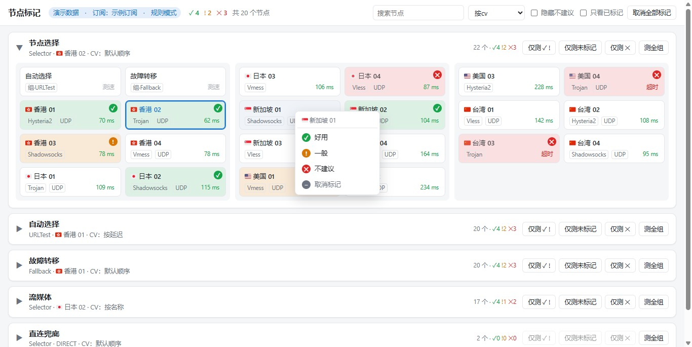

**中文** | [English](README.en.md)

# clash-verge-nodemark

给 [Clash Verge Rev](https://github.com/clash-verge-rev/clash-verge-rev) 的节点标记实际使用体验：在浏览器里打开一个和 Clash Verge 代理页一样的页面，右键节点卡片，标记为 ✓ 好用 / ! 一般 / ✕ 不建议，标记会直接显示在卡片上。

不改 Clash Verge 的任何设置，也不用改它的源码重新编译。本工具直接连接 Clash Verge 自带的 mihomo 内核，读到的代理组、当前节点、延迟和 Clash Verge 里看到的一致。只有一个 Node.js 脚本，没有依赖。



<sub>截图用的是演示模式的假数据（`node nodemark.js --demo`）。</sub>

## 功能

- **镜像代理组**：分组顺序、当前选中的节点、节点类型、延迟都和 Clash Verge 一样，每 3 秒刷新一次。
- **右键标记**：好用 / 一般 / 不建议 / 取消标记。标记后卡片显示对应颜色的底色和右上角徽标（彩色框只用来表示当前选中的节点），组标题旁显示每档数量。顶栏的「取消全部标记」一次取消当前订阅下的所有标记（会先确认，取消后不能恢复）。
- **左键切换节点**：和在 Clash Verge 里点一样，Clash Verge 会同步变化。
- **两种模式**：顶栏切换「用户标记」和「系统标记」。用户标记就是这里说的手动标记；系统标记按「测全组」的历史结果自动给节点打星（见下文「系统标记」）。
- **测延迟**（用户标记模式）：点卡片右下角测单个节点，点「测全组」测整组，点「仅测 ✓ !」只测本组里标为好用和一般的节点，点「仅测未标记」只测本组里还没标记的节点，点「仅测 ✕」只测本组里标为不建议的节点（看看有没有变好）。测速地址和超时沿用 Clash Verge 的设置。
- **筛选和排序**：搜索；按默认顺序 / cv / 延迟 / 标记 / 标记+延迟 / 名称排序；隐藏不建议的节点；只看已标记的节点。
- **按cv**：每个代理组沿用它在 Clash Verge 代理页里的排序方式（默认 / 按延迟 / 按名称），组标题下会注明用的是哪种（见下文「按cv 排序」）。
- **组内分栏**：代理组从上到下排列，每个组内部的节点分成三栏，每栏一行两个；节点按顺序先排满第一栏，再排下一栏。窗口变窄时自动改成两栏、一栏。
- **多订阅**：标记按订阅分开存，切换订阅不会串。
- **自动跟随节点变化**：每个订阅的节点清单以内核里的真实清单为准，自动增删（见下文「标记数据」）。

## 环境要求

- Clash Verge Rev 2.x，运行中。
- [Node.js](https://nodejs.org/) 16 或更高版本。

在 Windows 11 + Clash Verge Rev 2.5.8（mihomo v1.19.32）上实测通过。macOS 和 Linux 按 Clash Verge Rev 源码里的配置位置实现了，但还没有实测，遇到问题欢迎提 issue。

## 安装和运行

方式一：克隆后直接运行

```bash
git clone https://github.com/JackieRooot/clash-verge-nodemark.git
cd clash-verge-nodemark
node nodemark.js
```

方式二：全局安装成 `nodemark` 命令

```bash
npm install -g github:JackieRooot/clash-verge-nodemark
nodemark
```

运行后会在后台启动服务，倒数 3 秒后用默认浏览器打开 http://127.0.0.1:9099 （倒数时按 Ctrl+C 可以取消打开浏览器）。

后台服务什么时候退出：

- **只有关掉最后一个页面，服务才会退出。** 多次运行 `node nodemark.js` 会打开多个标签页，但它们共用同一个后台服务。关掉其中几个，只要还有一个页面开着，服务就继续运行，剩下的页面照常使用。
- 所有页面都关掉 15 秒后，服务自动退出。刷新页面不算关掉，下次用时再运行一次就行。
- 关掉运行命令的终端不影响后台服务。
- 服务已经在运行时，再运行命令不会再启动一个服务，只会多打开一个页面。

| 命令 | 作用 |
|---|---|
| `node nodemark.js` | 服务没在运行就在后台启动，然后打开浏览器 |
| `node nodemark.js --keep` | 同上，但关掉页面后服务不自动退出 |
| `node nodemark.js --no-open` | 只启动，不打开浏览器，也不自动退出 |
| `node nodemark.js stop` | 手动停掉后台服务，用于 `--keep`、`--no-open` 启动的服务，或者想立刻停掉的时候 |
| `node nodemark.js serve` | 在当前终端前台运行服务，日志直接打印出来，按 Ctrl+C 停止。平时用不到，排查问题时用 |
| `node nodemark.js --demo` | 演示模式：用假的节点数据，不需要装 Clash Verge，标记只存在内存里。默认端口 9098，停止用 `node nodemark.js stop --demo` |
| `--port <端口>` | 换端口，默认 9099，各命令都能加 |

想先看看效果，可以直接运行 `node nodemark.js --demo`。

### 设一个简写命令（可选）

PowerShell：在 `$PROFILE` 里加一个函数，把路径换成你自己的：

```powershell
function jd { node "D:\path\to\clash-verge-nodemark\nodemark.js" @args }
```

bash / zsh：在 `~/.bashrc` 或 `~/.zshrc` 里加：

```bash
alias jd='node ~/path/to/clash-verge-nodemark/nodemark.js'
```

用全局安装的话，直接输入 `nodemark` 就行。

## 系统标记

在顶栏切到「系统标记」后，页面不再显示手动标记，改为显示每个节点的推荐指数（0–5 星，半星一档），用来衡量节点在较长一段时间里的平均表现。

- 只能点「测全组」，不能测单个节点，也没有「仅测」按钮和右键标记菜单。每次测全组，组里每个真实节点记一个样本（代理组、DIRECT 这类不记），测完马上更新推荐指数。用户标记模式下点的「测全组」不记。
- 每个节点保留最近 30 个样本。同一个节点出现在多个组里时，共用一份历史。
- 卡片上显示星级、样本数和超时次数，样本少于 3 个时标「样本不足」。鼠标停在星级上，能看到没取整的分数和是否因超时封顶。排序里可以选「按推荐指数」。

### 评分规则

每个样本先按延迟换算成单次分。用哪套档位，看测试时 Clash Verge 的「统一延迟」开没开（每个样本都记下了当时的开关，切换开关后新旧样本各按各的档位算）：

| 档 | 没开统一延迟 | 开了统一延迟 | 单次分 | 权重 |
|---|---|---|---|---|
| S | < 800 ms | < 200 ms | 5 | 1 |
| A | 800–1100 ms | 200–400 ms | 4 | 1 |
| B | 1100–1500 ms | 400–700 ms | 3 | 1.5 |
| C | 1500–2200 ms | 700–1200 ms | 2 | 2 |
| D | 2200–3500 ms | 1200–2500 ms | 1 | 3 |
| 超时 | ≥ 3500 ms、超时或失败 | ≥ 2500 ms、超时或失败 | 0 | 6 |

越差的档权重越大，差的结果把分数往下拽得比好的结果往上拉得更狠。「开了统一延迟」那套档位还没实测过，是估算。

推荐指数 = (Σ 权重 × 单次分 + 3) ÷ (Σ 权重 + 1)，四舍五入到半星。分子分母里多出的那一项相当于先垫了一次 3 分的结果，所以新节点测一次拿不到满分，连续 7 次落在 S 档才到 5 星。

算出来之后，再按最近 30 个样本里的超时情况封顶（慢于最后一档上限的也算超时）：

| 超时情况 | 最高 |
|---|---|
| 没有超时 | 不封顶 |
| 1 次 | 2 星 |
| 2 次以上，或超时率 ≥ 15% | 1 星 |
| 超时率 ≥ 40% | 0 星 |

一个组里至少有 4 个节点、而且这一轮 60% 以上超时时，多半是本机网络出了问题，这一轮整轮不计入，页面上会提示。

## 标记数据

标记存在 `marks.json` 里，按订阅（Clash Verge `profiles.yaml` 里的 uid）分开记录：

| 系统 | 位置 |
|---|---|
| Windows | `%APPDATA%\clash-verge-nodemark\marks.json` |
| macOS | `~/Library/Application Support/clash-verge-nodemark/marks.json` |
| Linux | `~/.local/share/clash-verge-nodemark/marks.json`（设置了 `XDG_DATA_HOME` 时放在它下面） |

节点清单的同步规则：

- 新出现的节点自动加进清单，不带标记。
- 已经不存在的节点从清单里删掉。如果它带标记，会记进该订阅的 `removed` 列表（保留最近 200 条），页面底部显示最近的记录，方便节点改名后照着重新标。
- 只同步当前订阅，其他订阅的记录保持不动。
- 防误删：同一订阅下，同一份节点清单要稳定 5 秒以上才同步，避免切换订阅的过渡期把清单删错。

系统标记的测速历史也存在 `marks.json` 里，记在各个节点下面（`samples`），节点从清单里删掉时一起删掉。

标记和测速历史都按节点名匹配，机场给节点改名后，原来的记录就对不上了。`marks.json` 损坏打不开时，程序会先另存一份 `marks.json.broken-<时间戳>`，再从空记录开始。

## 原理

Clash Verge Rev 会把它和内核通信用的控制接口写进运行时配置 `clash-verge.yaml`：Windows 上是命名管道（`external-controller-pipe`），macOS / Linux 上是 Unix socket（`external-controller-unix`）。本工具从这个文件读到地址和密钥，通过同一个接口读代理组、切节点、测延迟，所以不需要打开 Clash Verge 的「外部控制」。如果没有管道或 socket，但开了「外部控制」，就改用 HTTP 地址。

Clash Verge 的数据目录默认在：

| 系统 | 位置 |
|---|---|
| Windows | `%APPDATA%\io.github.clash-verge-rev.clash-verge-rev` |
| macOS | `~/Library/Application Support/io.github.clash-verge-rev.clash-verge-rev` |
| Linux | `~/.local/share/io.github.clash-verge-rev.clash-verge-rev` |

### 按cv 排序

Clash Verge 代理页每个组的排序方式（组标题栏里的排序按钮）存在它内置 WebView2 的 localStorage 里，键名是 `proxy-head-state`，按订阅分开记录。本工具直接读这份数据，位置在 `%LOCALAPPDATA%\io.github.clash-verge-rev.clash-verge-rev\EBWebView\Default\Local Storage\leveldb`，格式是 LevelDB。只读，不写。

- 「按延迟」的规则和 Clash Verge 一样：先排测出延迟的（从小到大），再排超时的，然后是失败的，最后是没测过的。超时阈值沿用 Clash Verge 的设置。
- 在 Clash Verge 里改了排序后，WebView 要过几秒才会写到磁盘，所以本页面可能晚几秒才跟上。
- 只支持 Windows。macOS / Linux 上的 WebView 存储格式不同，选「按cv」时所有组都按默认顺序排，组标题下会注明。

### 环境变量

都不是必需的，默认情况下不用设置。

| 变量 | 作用 |
|---|---|
| `NODEMARK_PORT` | 页面端口，默认 9099（`--port` 优先） |
| `NODEMARK_DATA_DIR` | 标记文件和日志放在哪个目录 |
| `NODEMARK_TEST_URL` | 测速地址，默认用 Clash Verge 的设置，没设就用 `https://cp.cloudflare.com/generate_204` |
| `VERGE_DIR` | Clash Verge 的数据目录，装在非默认位置（例如便携版）时用 |
| `CLASH_API` | 直接指定内核的 HTTP 控制地址，例如 `http://127.0.0.1:9097` |
| `CLASH_SOCKET` | 直接指定命名管道或 Unix socket 路径 |
| `CLASH_SECRET` | 内核的控制密钥 |

用 `CLASH_API` 还可以连其他基于 mihomo / Clash Meta 内核的客户端。这时没有 Clash Verge 的订阅信息，所有标记都记在名为 `default` 的订阅下。

## 安全

- 服务只监听 `127.0.0.1`，只接受 Host 为 `127.0.0.1` 或 `localhost` 的请求。
- 接口要求一个自定义请求头。其他网页的跨域请求会先触发浏览器预检，这里不应答，所以别的网页没法偷偷调用接口切换你的节点。
- 页面能切换节点、触发测速，不要通过端口转发等方式把它暴露到局域网或公网。

## 常见问题

**页面显示「连不上 mihomo 内核」**：Clash Verge 没开，或者内核正在重启。打开 Clash Verge 后等几秒，页面会自动恢复。

**页面显示「本地服务已停止」**：后台服务已经自动退出了，重新运行一次 `node nodemark.js` 就行。如果页面没关也遇到这种情况，多半是浏览器的省内存功能（比如 Chrome 的 Memory Saver）把长时间没看的标签页冻结了，服务以为页面关掉了。不想遇到的话，用 `--keep` 启动。

**选「按cv」后组标题下显示「后台服务是旧版本」，或者点「取消全部标记」、系统标记模式下点「测全组」时提示后台服务是旧版本**：更新代码后页面刷新就是新的，但后台服务要重启才会更新。运行 `node nodemark.js stop`，再运行一次 `node nodemark.js`。

**提示端口被占用**：用 `--port` 换一个端口。

**国旗显示成两个字母**：Windows 自带字体不画国旗 emoji，页面会从 jsDelivr 加载一个只含国旗的字体来补。网络访问不了 jsDelivr 时就显示成字母，不影响其他功能。

**后台服务出错了**：看日志 `nodemark.log`，和 `marks.json` 在同一个目录。也可以用 `node nodemark.js serve` 在前台运行，直接看输出。

## 许可证

[MIT](LICENSE)
